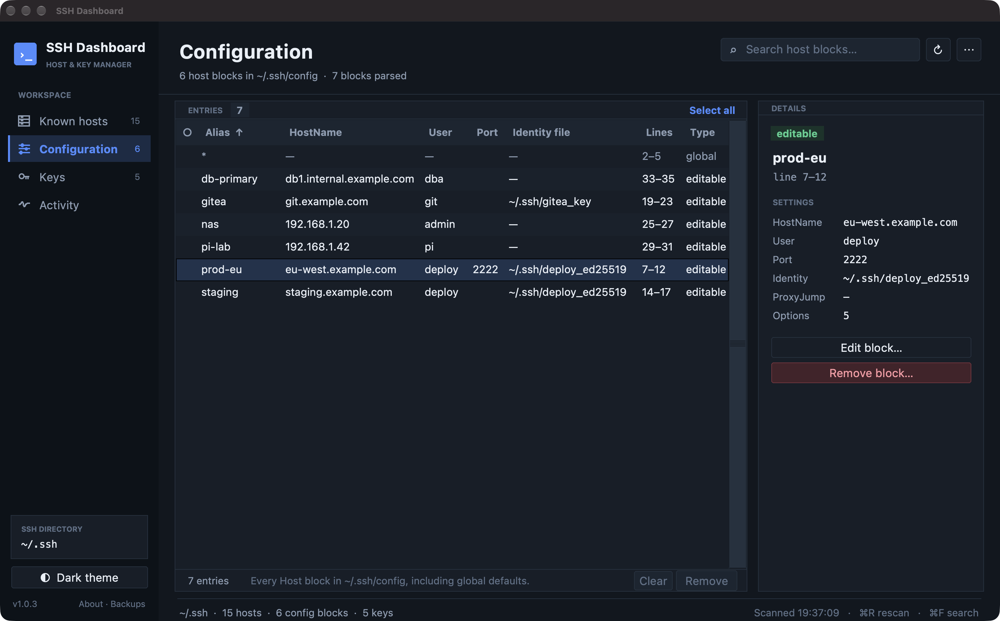
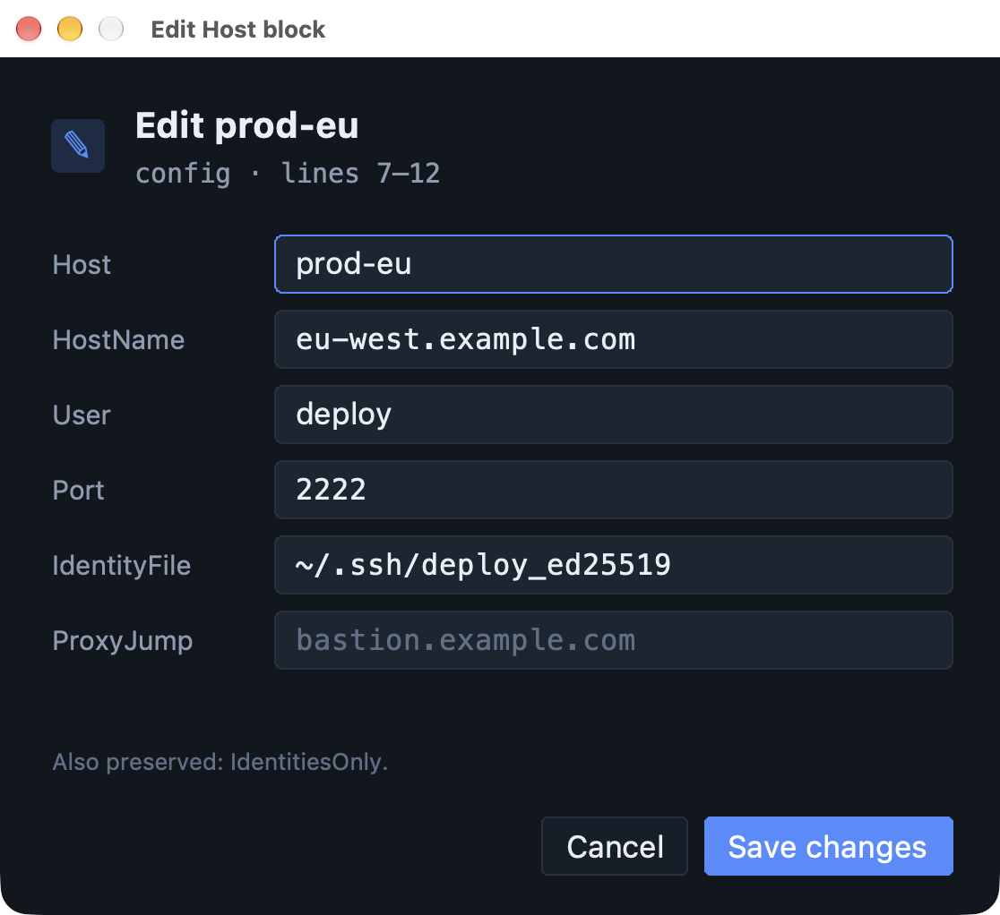
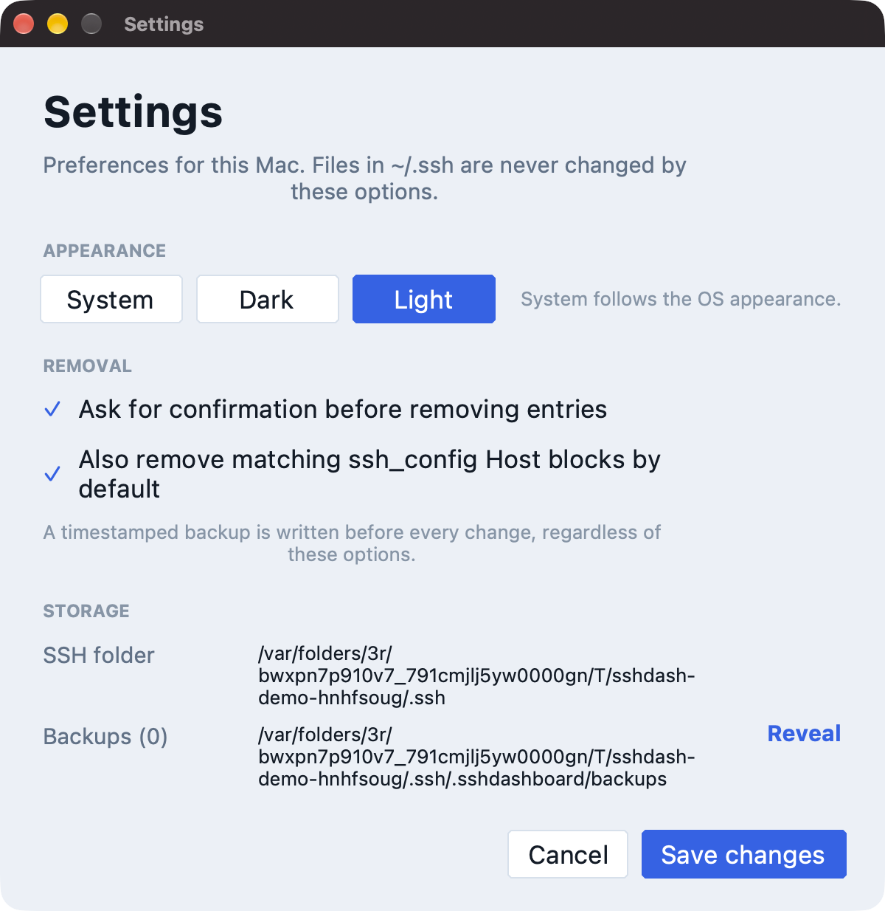
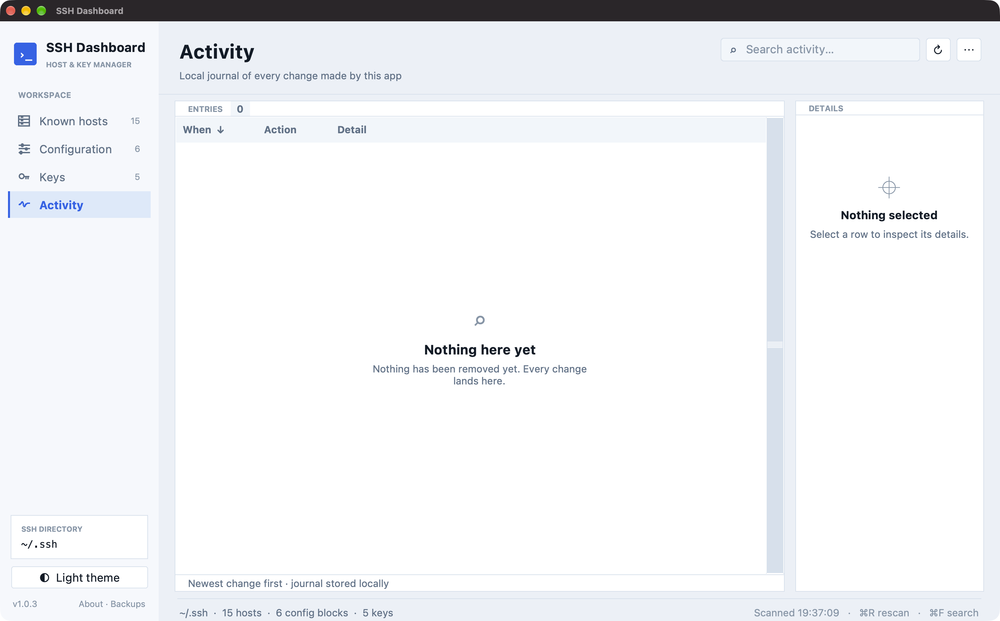

<p align="center">
  
</p>

<h1 align="center">SSH Dashboard</h1>

<p align="center">
  Every host in <code>~/.ssh</code>, in one clean dashboard.<br>
  Known hosts · ssh_config blocks · keys — inspect, edit and remove safely.
</p>

<p align="center">
  
  
  
  
  
  
  
  <a href="https://github.com/jphermans/ssh-dashboard/actions/workflows/build-windows.yml">
    
  </a>
</p>

---

SSH Dashboard is a desktop app for the files OpenSSH keeps in `~/.ssh`. It reads
`known_hosts`, `ssh_config` and your key pairs, explains what each entry actually
means, and lets you remove or edit entries with backups and undo instead of
hand-editing text files.

Built with the Python standard library only — Tkinter, no third-party runtime.

## Screenshots

<table>
  <tr>
    <td width="50%"></td>
    <td width="50%"></td>
  </tr>
  <tr>
    <td><sub><b>Known hosts</b> — every key type per host, the matching config alias, and a details rail with fingerprints and a connection test.</sub></td>
    <td><sub><b>Configuration</b> — every Host block, including globals and included files. Editable blocks show an inline editor.</sub></td>
  </tr>
  <tr>
    <td></td>
    <td></td>
  </tr>
  <tr>
    <td><sub><b>Block editor</b> — change patterns, HostName, user, port, identity file and ProxyJump; comments and unknown options are preserved.</sub></td>
    <td><sub><b>Settings</b> — theme, confirmation behaviour and backup defaults. Screenshots use fictional demo hosts.</sub></td>
  </tr>
  <tr>
    <td></td>
    <td></td>
  </tr>
  <tr>
    <td><sub><b>Keys</b> — real fingerprints, passphrase status and file mode. Read-only by design.</sub></td>
    <td><sub><b>Activity</b> — a local journal of every removal, edit and restore, with backup paths.</sub></td>
  </tr>
</table>

## Features

- **Known hosts** — groups the multiple key types recorded for a host into one
  row, resolves the matching `ssh_config` block (alias, user, port, identity
  file) and shows SHA-256 fingerprints.
- **Selection and bulk removal** — tick rows in the first column (or `⌘A`,
  `Space`), review the confirmation dialog, remove them in one action. Undo is
  one click away.
- **Configuration editing** — edit `Host` patterns, `HostName`, `User`, `Port`,
  `IdentityFile` and `ProxyJump` in a dialog. Comments and unknown directives
  survive untouched; only literal blocks in the main config are writable.
- **Keys view** — type, bits, SHA-256 fingerprint, comment, passphrase status and
  file mode, with copy-to-clipboard and Reveal. Keys are never modified.
- **Details rail** — fingerprints, `known_hosts` line numbers, the exact `ssh`
  command, and a live TCP reachability check for the selected host.
- **Full menu bar** — native macOS application menu (About, Settings, Hide,
  Quit) plus File, Edit, View, Tools, Window and Help menus. On Windows and
  Linux the same menus render in-window with `Ctrl` accelerators.
- **Export** — write the visible rows of any view to CSV.
- **Activity journal** — every destructive action is logged locally.
- **Light and dark themes** — a slate dark theme and a grey-blue light theme,
  both hand-drawn; no native widget colours leak through.
- **Cross-platform** — macOS, Windows and Linux; per-monitor DPI aware on
  Windows with a taskbar icon.

## Install

The published builds are deliberately small: they contain **no Python runtime**.
They use the Python already installed on the machine and offer a download link
when none is found.

### macOS (~1 MB)

1. Download `SSH-Dashboard-1.0.1-macOS-lite.dmg` from
   [Releases](https://github.com/jphermans/ssh-dashboard/releases/latest).
2. Open the DMG and drag **SSH Dashboard** into *Applications*.
3. On first launch (and whenever the Python version changes) the app confirms
   which interpreter it found, e.g. *"Python 3.14.8 with Tk 9.1 detected."*
   If no suitable Python is installed it explains what is missing and offers the
   python.org download.

The bundle is ad-hoc signed and not notarized. If macOS quarantines a downloaded
copy, right-click the app → **Open** once.

### Windows (~70 KB launcher)

1. Download `SSH-Dashboard-1.0.1-windows-x64.zip` from
   [Releases](https://github.com/jphermans/ssh-dashboard/releases/latest).
2. Extract the whole folder and run **SSH Dashboard.exe**.
3. If Python is present, the launcher shows the detected version once per
   version. If it is missing, the launcher offers to install Python 3.13 with
   winget, verifies that Tk works, then starts the app. Without winget it opens
   the python.org download page.

### Linux

```bash
./run.sh
# or
python3 ssh_dashboard.py
```

### Requirements

- Python **3.9+** with **Tk 8.6+**.
  - macOS: `brew install python-tk@3.14` (Homebrew's framework Python includes Tk)
    or a python.org build.
  - Windows: the python.org installer (includes Tk).
  - Linux: `sudo apt install python3-tk`.
- macOS's built-in Python 3.9 ships Tk 8.5 and cannot map this window. The app
  detects this before creating a window, relaunches with a supported interpreter
  when one is present, and otherwise explains what to install.

### From source

```bash
git clone https://github.com/jphermans/ssh-dashboard.git
cd ssh-dashboard
./run.sh                       # macOS / Linux
python3 ssh_dashboard.py --check
python3 -m unittest discover -s tests -v
```

## Usage

- **Switch views** with the sidebar or `⌘1` … `⌘4`.
- **Select entries** by clicking the box in the first column. Row selection (for
  the details panel) is separate from this checkbox model.
- **Remove** with the footer button, `Delete`, or Edit → Undo Removal.
- **Edit a Host block** by double-clicking a row in Configuration, using the
  details rail, or Tools → Edit Selected Block.
- **Search** narrows the current view live; sorting is a click on any header.
- **Themes** live under View → Appearance and in Settings.

## Safety model

Deleting the wrong host is annoying; corrupting `known_hosts` is worse. The app:

1. writes a timestamped backup to `~/.ssh/.sshdashboard/backups/` **before**
   any write (`<stamp>__known_hosts`, `<stamp>__config`);
2. rewrites files atomically (temp file + `fsync` + `os.replace`) and keeps the
   original permissions;
3. removes only the exact tokens selected — a line listing several hosts keeps
   the others;
4. understands hashed `known_hosts` entries (`|1|salt|hash`) via HMAC-SHA1, so
   hashing does not have to be disabled;
5. re-parses `ssh_config` at write time and refuses stale edits;
6. never touches `Include`d files, global `Host *` blocks or wildcard blocks;
7. preserves CRLF line endings and unknown directives byte-for-byte;
8. offers **Undo** after every removal or edit.

## Keyboard

`⌘` on macOS, `Ctrl` on Windows and Linux.

| Shortcut | Action |
| --- | --- |
| `⌘R` | Rescan `~/.ssh` |
| `⌘F` | Focus search |
| `⌘E` | Export visible rows to CSV |
| `⌘A` / `⇧⌘A` | Select all visible / deselect all |
| `⌘Z` | Undo the last removal or edit |
| `⌘1` … `⌘4` | Known hosts / Configuration / Keys / Activity |
| `⌘,` | Settings |
| `⌘/` | Keyboard shortcuts |
| `Space` | Tick the focused row |
| `Delete` / `Backspace` | Remove selected rows |
| `Esc` | Clear search, then selection |
| Double-click a config row | Edit that Host block |
| Click a column header | Sort, click again to reverse |

## Project layout

```
ssh_dashboard.py          entry point (--check for diagnostics)
sshdash/
  model.py                immutable value objects (HostView, ConfigBlock, …)
  parsers.py              read-only known_hosts / ssh_config / key parsers
  store.py                the only writer: backups, atomic saves, deletion, edits
  config.py               settings, activity journal, platform paths
  runtime.py              Tk guard, platform setup (DPI, relaunch)
  ui/
    theme.py              palettes, typography, ttk styling
    widgets.py            rounded buttons, fields, toasts, dialogs, editors
    app.py                window, menu bar, layout and interactions
    branding.py           icon loading (works from source and bundled)
    assets/               icon PNGs, SSHDashboard.icns, SSHDashboard.ico
launcher/windows/         tiny native Windows launcher (C)
tests/                    core, cross-platform and real-window UI tests
tools/                    icon generator, screenshot capture, UI probes
packaging/                lite app builder, launcher build, optional fat build
docs/screenshots/         screenshots used above
```

## Tests

```bash
python3 -m unittest discover -s tests -v
```

43 tests cover parsers, deletion, config editing, backups, permission and CRLF
preservation, the runtime guard, the menu bar, dialogs, CSV export and a real
window driven through every view. UI tests are skipped automatically without a
display. Destructive probes run against a throwaway `HOME`, never your `~/.ssh`.

## Packaging

The default builds are lightweight and require Python on the target machine:

```bash
python3 packaging/build_macos_lite.py     # ~1 MB .app + zip
./packaging/build_windows_lite.sh         # mingw cross-build, ~70 KB launcher
packaging\build-windows.bat               # MSVC build on Windows
```

The Windows CI workflow builds the launcher on a real Windows runner, runs the
test suite and checks that the executable stays under 300 KB.

A fully self-contained PyInstaller build is still available for machines without
Python (much larger, ~30 MB):

```bash
./packaging/build-macos-fat.sh            # dist/SSH Dashboard.app
```

Icons ship as PNGs for Tk, `.icns` for macOS and `.ico` for Windows. Regenerate
all sizes deterministically with:

```bash
python3 tools/make_icon.py                # requires Pillow
```

## Troubleshooting

- **"Python required" dialog** — install Python 3.9+ from python.org (Windows:
  enable *Add python.exe to PATH*), then relaunch.
- **"SSH Dashboard needs Tk 8.6 or newer"** — the interpreter is too old. On
  macOS use `brew install python-tk@3.14`; on Linux install `python3-tk`.
- **`ImportError: No module named '_tkinter'`** — your Python was built without
  Tk. Use `./run.sh`, which only accepts interpreters with Tk 8.6+.
- **Restore a change** — use Undo, or copy the matching file from
  `~/.ssh/.sshdashboard/backups/` over the original.
- **Hashed known_hosts** — supported; hashed rows appear as `hashed · <digest>…`
  because a hash can only be verified, not reversed.
- **Unexpected error dialog** — the traceback is appended to
  `~/Library/Application Support/SSHDashboard/error.log` (macOS) or
  `%APPDATA%\SSHDashboard\error.log` (Windows).
- **Windows launcher** — keep `SSH Dashboard.exe`, `install-python.ps1`,
  `ssh_dashboard.py` and the `sshdash` folder together; the launcher resolves
  the script next to itself.
- **Windows automatic install** — uses winget, the Windows package manager.
  NuGet's `python` package is not used because it ships without Tcl/Tk, so
  `tkinter` cannot start; winget installs the full build with Tk. Installation
  details are written to `%LOCALAPPDATA%\SSHDashboard\install.log`.
- **Python confirmed on every machine** — the detection dialog appears once per
  Python/Tk version and can be dismissed permanently by continuing.

## Configuration

Preferences live in `~/Library/Application Support/SSHDashboard/settings.json`
(macOS), `%APPDATA%\SSHDashboard\settings.json` (Windows) or
`~/.config/sshdashboard/settings.json` (Linux). They cover theme, confirmation
behaviour and default config-block removal.

On Windows the SSH folder is `%USERPROFILE%\.ssh`. System-wide OpenSSH files
under `C:\ProgramData\ssh` are intentionally not touched.

---

<p align="center"><sub>Built by JPHsystems · macOS, Windows and Linux · Python + Tk</sub></p>
