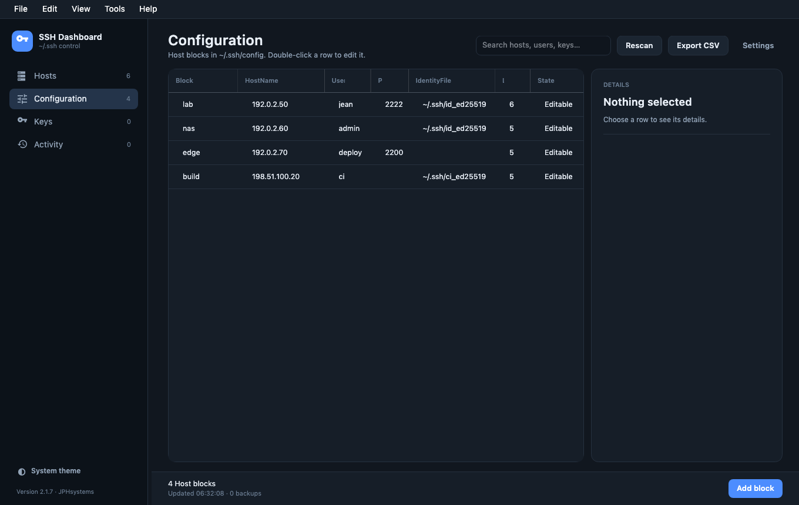
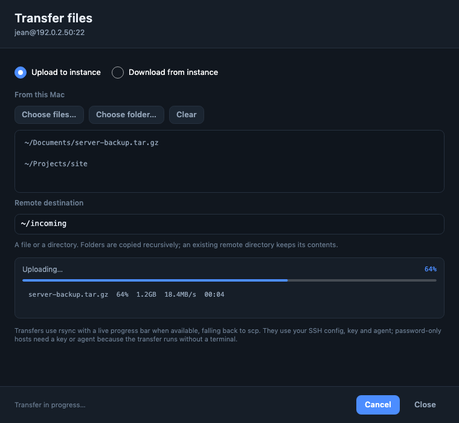
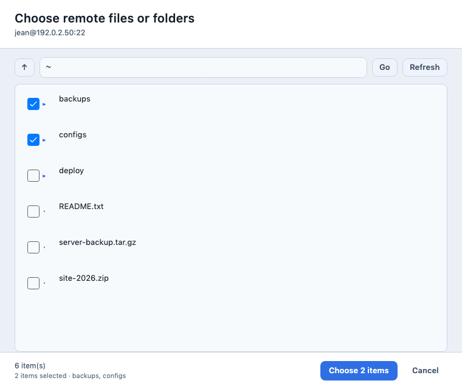
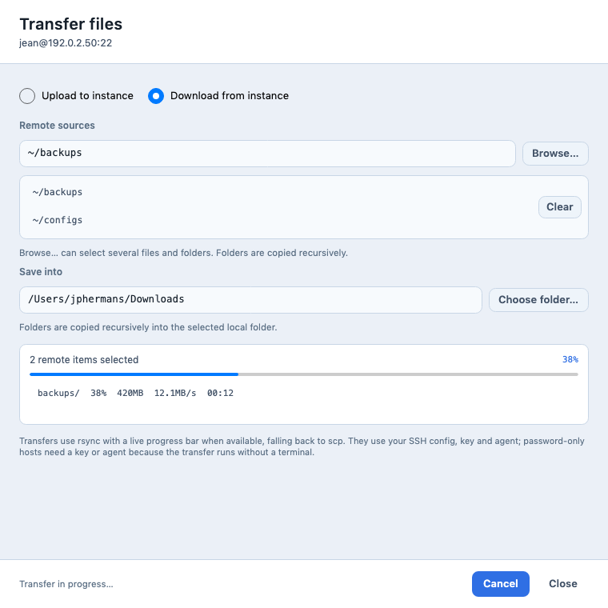
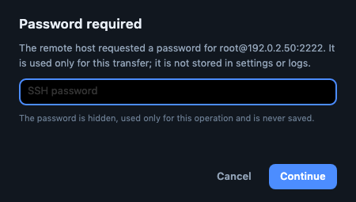

# SSH Dashboard


**A careful desktop dashboard for `~/.ssh`.** It lists every host in `known_hosts`
and `ssh_config`, every key pair, lets you remove entries safely, edit Host
blocks, open an SSH session, and copy files to or from a connected instance —
all with timestamped backups and a local activity journal.

Built with **.NET 10** and **Avalonia** for macOS, Windows and Linux.

**[Website and downloads →](https://jphermans.github.io/ssh-dashboard/)** · **[Support →](https://jphermans.github.io/ssh-dashboard/support.html)**

<br clear="left">


[](https://github.com/jphermans/ssh-dashboard/actions/workflows/build.yml)
[](https://github.com/jphermans/ssh-dashboard/releases/latest)


**Configuration — adding a Host block**



**File transfer — upload files or folders to a connected instance**



**Remote file browser — select one or more files and folders to download**



**Download several remote items — the selected list stays visible**



**Password prompt — hidden input when the host asks for one**



## Features

- **Hosts** — merges `known_hosts` and `ssh_config` (including `Include`d files)
  into one list, showing address, user, port, key types and where each entry
  comes from. Hashed `known_hosts` entries are listed and removable too. Select
  rows with the checkboxes and remove them in one action.
- **Open SSH session** — button, Tools menu, footer action or double-click.
  Uses the `ssh_config` alias when there is one, so `ProxyJump`, `IdentityFile`
  and ports behave exactly as on the command line; otherwise
  `ssh user@address -p port`. The session opens in an in-app terminal window.
- **Configuration** — every `Host` block with HostName, User, Port and
  IdentityFile. Add a new block from the footer, Tools menu or `Cmd/Ctrl+N`;
  double-click to edit patterns and options. Comments and unknown options are
  preserved. `Match` and `Host *` blocks are read-only.
- **File transfer** — open **Files…** in an SSH session to upload files or folders
  to the instance, or download one or more remote files or folders into your
  Downloads folder (or another folder you choose). Use native local pickers, drag and drop, or
  **Browse…** to pick the remote folder, or tick one or more files and folders in a live remote list.
  Both directions use `rsync` with a live progress bar (falling back to `scp`)
  with your SSH config, key and agent. A successful upload clears the source list
  so it cannot be copied twice by accident. If the host asks for a password, a
  hidden password prompt appears; it is used only for that transfer and is
  never stored. PuTTY `.ppk` keys are converted automatically for transfers.
- **PuTTY keys** — import `.ppk` files with a file dialog (validated, copied into `~/.ssh`, named after the selected host) or drop them there directly. `.ppk` v2/v3 files are recognised with their fingerprint. Unencrypted RSA/Ed25519 PPKs are converted to a temporary OpenSSH key for sessions, then deleted; passphrase-protected PPKs prompt once and convert through `puttygen` when installed.
- **Keys** — private and public key files with type, SHA256 fingerprint, size
  and file permissions.
- **Activity** — a local journal of each removal, edit, import, undo and restore.
- **Backups** — a browser for every timestamped backup, with restore. Retention
  is 30 days or 200 files, whichever is smaller.
- **Undo** — restores every file touched by the last action, not just one.
- **Themes** — System, Dark and Light. System follows the OS, including changes
  while the app is open. The choice is persisted.
- **Resizable workspace** — draggable splitters for the sidebar and details
  rail, star-sized table columns, 1040×640 minimum window.
- **Export** — the current view to CSV.
- **Connection test** — TCP port check; on macOS it uses `/usr/bin/nc`, so no
  Local Network permission is needed.
- **Safe writes** — an exclusive write lock, atomic replacement and preserved
  permissions; non-UTF-8 comments survive deletion byte-for-byte.

## Safety model

Every write follows the same path:

1. The target file is copied to
   `~/.ssh/.sshdashboard/backups/<timestamp>-<name>`.
2. Deletion re-reads and re-parses the file, removing only lines or blocks that
   still match the selection.
3. Data is written to a temporary file in the same directory, the original
   permissions are applied, then an atomic rename replaces the file.
4. The action is appended to the activity journal.

The app never writes outside `~/.ssh`. `Include`d files and `Match` / global
`Host *` blocks are read-only; only the main `config` is edited.

## Download

All builds are self-contained — no .NET runtime required on the target.

| Platform | File |
| --- | --- |
| macOS 12+ (Apple silicon) | [`SSH-Dashboard-macOS-arm64.dmg`](https://github.com/jphermans/ssh-dashboard/releases/latest/download/SSH-Dashboard-macOS-arm64.dmg) |
| Windows 10/11 x64 — installer | [`SSH-Dashboard-Setup.exe`](https://github.com/jphermans/ssh-dashboard/releases/latest/download/SSH-Dashboard-Setup.exe) |
| Windows 10/11 x64 — portable | [`SSH-Dashboard-windows-x64.zip`](https://github.com/jphermans/ssh-dashboard/releases/latest/download/SSH-Dashboard-windows-x64.zip) |
| Linux x64 | [`SSH-Dashboard-linux-x64.tar.gz`](https://github.com/jphermans/ssh-dashboard/releases/latest/download/SSH-Dashboard-linux-x64.tar.gz) |

These links point at the latest release, so they never go stale. Checksums:
[`SHA256SUMS.txt`](https://github.com/jphermans/ssh-dashboard/releases/latest/download/SHA256SUMS.txt).

### macOS

Open the DMG and drag **SSH Dashboard** into *Applications*. The DMG is a
Apple silicon binary for macOS 12 or newer.

The build is ad-hoc signed and **not notarized**, so a downloaded copy is
quarantined by Gatekeeper. On first launch use **System Settings → Privacy &
Security → Open Anyway**, or right-click the app → **Open**. To clear the
quarantine flag directly:

```sh
xattr -dr com.apple.quarantine "/Applications/SSH Dashboard.app"
```

A fully double-click install needs a Developer ID certificate and Apple
notarization. The exact commands are in
[`internal/APP-STORE.md`](internal/APP-STORE.md), together with the Mac App Store
assessment (the current sandbox-dependent design is not App Store-ready). That
file lives outside `docs/` on purpose: GitHub Pages serves every file under
`docs/` as a public URL, so build and signing notes must not go there.

### Windows installer

A branded EXE installer is built **manually**, never on a push:

1. Open **Actions → windows-installer → Run workflow**.
2. Enter the version (for example `2.1.14`) and run it.
3. The run attaches `SSH-Dashboard-<version>-Setup.exe` to the matching GitHub
   release, and also uploads it as a workflow artifact.

It installs per-user (no administrator prompt), creates a Start menu entry and
an optional desktop shortcut, registers an uninstaller in Apps & features, and
uses the app icon throughout. The wizard artwork lives in `installer/assets/`
and is regenerated by `installer/generate-artwork.py`.

### Windows and Linux binaries

Build a self-contained binary (no .NET runtime needed on the target):

```sh
# Windows x64
dotnet publish dotnet/src/SshDashboard.App -c Release -r win-x64 \
  --self-contained true -p:PublishSingleFile=true \
  -p:IncludeNativeLibrariesForSelfExtract=true -o out/win

# Linux x64
dotnet publish dotnet/src/SshDashboard.App -c Release -r linux-x64 \
  --self-contained true -p:PublishSingleFile=true \
  -p:IncludeNativeLibrariesForSelfExtract=true -o out/linux
```

CI builds all three platforms on every push and publishes a tagged release
with checksums (see `.github/workflows/build.yml`).

## Build and run

Requires the [.NET 10 SDK](https://dotnet.microsoft.com/download).

```sh
cd dotnet
dotnet restore
dotnet run --project src/SshDashboard.App
dotnet test
```

The `--check` switch prints what the app sees without opening a window:

```sh
dotnet run --project src/SshDashboard.App -- --check
```

## Keyboard shortcuts

| Shortcut | Action |
| --- | --- |
| `F5` | Rescan `~/.ssh` |
| `Delete` | Remove the selected rows or block |
| `Cmd/Ctrl + A` | Select all hosts |
| `Cmd/Ctrl + E` | Export the current view |
| `Cmd/Ctrl + N` | Add a Host block |
| `Cmd/Ctrl + ,` | Settings |
| `Cmd/Ctrl + Z` | Undo the last change, restoring every file it touched |
| `Cmd/Ctrl + 1…4` | Hosts, Configuration, Keys, Activity |
| `Cmd/Ctrl + Shift + T` | Open an SSH session |

## Project layout

```
dotnet/
  SshDashboard.slnx
  src/
    SshDashboard.Core/    parsers, store, backups, settings, platform helpers
    SshDashboard.App/     Avalonia UI, view models, dialogs, SSH launcher
  tests/
    SshDashboard.Core.Tests/
  assets/                 .icns and PNG icon sources
docs/screenshots/         README images (fictional demo data)
```

The store is the only component that writes; the UI calls it and reloads the
snapshot afterwards.

## Testing

```sh
dotnet test dotnet/SshDashboard.slnx
```

Twenty-five tests run against temporary folders and never touch your real
`~/.ssh`:

- **Core** — `known_hosts` parsing (shared lines, hashed hosts, ports),
  merging with `ssh_config`, deletion with backups, config editing with comment
  preservation, undo across several files, restore, CSV escaping, `Include`d
  blocks read-only, and PuTTY conversion.
- **App** — SSH command construction (aliases, IPv6, ports, keys), transfer
  arguments, remote-path escaping, authentication-failure detection, and
  askpass permissions and cleanup.

## License

Proprietary. Copyright © 2026 Jean-Pierre Hermans. All rights reserved.

Bundled open-source components keep their own licenses: Avalonia UI (MIT),
VtNetCore (MIT) and .NET (MIT). SSH connections use the system OpenSSH client,
which is not distributed with this app.

---

<p align="center"><sub>Built by <b>JPHsystems</b> · macOS, Windows and Linux · .NET + Avalonia</sub></p>
