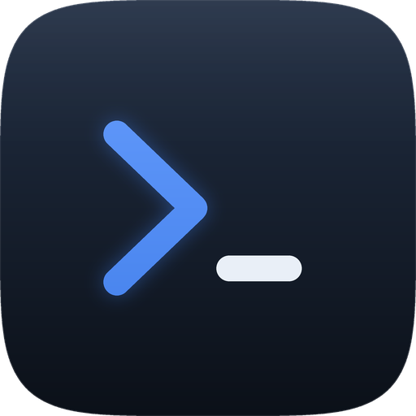
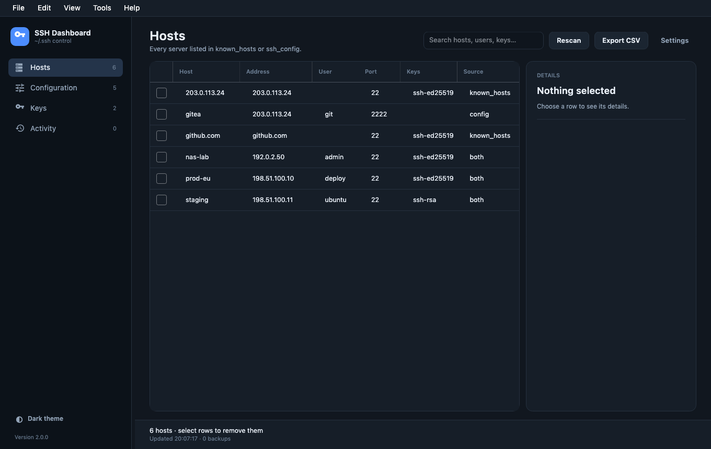
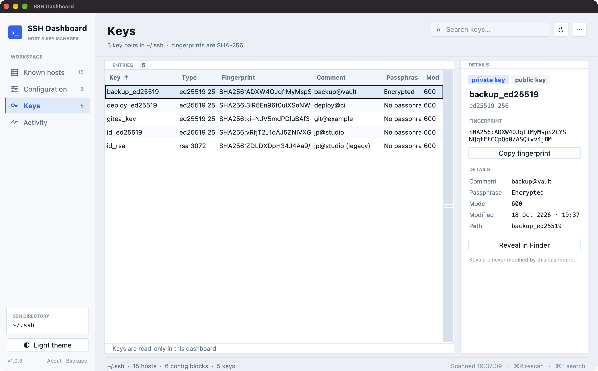

# SSH Dashboard



**A careful desktop dashboard for `~/.ssh`.** It lists every host in `known_hosts`
and `ssh_config`, every key pair, lets you remove entries safely, edit Host
blocks, and open an SSH session — all with timestamped backups and a local
activity journal.

Built with **.NET 10** and **Avalonia** for macOS, Windows and Linux.

<br clear="left">






## Features

- **Hosts** — merges `known_hosts` and `ssh_config` into one list, showing
  address, user, port, key types and where each entry comes from. Select rows
  with the checkboxes and remove them in one action.
- **Open SSH session** — button, Tools menu, footer action or double-click.
  Uses the `ssh_config` alias when there is one, so `ProxyJump`, `IdentityFile`
  and ports behave exactly as on the command line; otherwise
  `ssh user@address -p port`. The session opens in an in-app terminal window.
- **Configuration** — every `Host` block with HostName, User, Port and
  IdentityFile. Double-click to edit patterns and options; comments and unknown
  options are preserved. `Match` and `Host *` blocks are read-only.
- **PuTTY keys** — `.ppk` files (v2/v3) are recognised in the Keys view with their fingerprint. Unencrypted RSA/Ed25519 PPKs are converted to a temporary OpenSSH key for sessions, then deleted.
- **Keys** — private and public key files with type, SHA256 fingerprint, size
  and file permissions.
- **Activity** — a local journal of each removal, edit and restore.
- **Themes** — System, Dark and Light. System follows the OS, including changes
  while the app is open. The choice is persisted.
- **Resizable workspace** — draggable splitters for the sidebar and details
  rail, star-sized table columns, 1040×640 minimum window.
- **Export** — the current view to CSV.
- **Connection test** — TCP port check; on macOS it uses `/usr/bin/nc`, so no
  Local Network permission is needed.

## Safety model

Every write follows the same path:

1. The target file is copied to
   `~/.ssh/.sshdashboard/backups/<timestamp>-<name>`.
2. Deletion re-reads and re-parses the file, removing only lines or blocks that
   still match the selection.
3. Data is written to a temporary file in the same directory, the original
   permissions are applied, then an atomic rename replaces the file.
4. The action is appended to the activity journal.

The app never writes outside `~/.ssh`, never follows `Include`d files, and never
edits `Match` or global `Host *` blocks.

## Download

All builds are self-contained — no .NET runtime required on the target.

| Platform | File |
| --- | --- |
| macOS Apple Silicon | [`SSH-Dashboard-2.0.6-macOS-arm64.dmg`](https://github.com/jphermans/ssh-dashboard/releases/download/v2.0.6/SSH-Dashboard-2.0.6-macOS-arm64.dmg) |
| macOS Intel | [`SSH-Dashboard-2.0.6-macOS-x64.dmg`](https://github.com/jphermans/ssh-dashboard/releases/download/v2.0.6/SSH-Dashboard-2.0.6-macOS-x64.dmg) |
| Windows 10/11 x64 | [`SSH-Dashboard-2.0.6-windows-x64.zip`](https://github.com/jphermans/ssh-dashboard/releases/download/v2.0.6/SSH-Dashboard-2.0.6-windows-x64.zip) |
| Linux x64 | [`SSH-Dashboard-2.0.6-linux-x64.tar.gz`](https://github.com/jphermans/ssh-dashboard/releases/download/v2.0.6/SSH-Dashboard-2.0.6-linux-x64.tar.gz) |

Checksums: [`SHA256SUMS-2.0.6.txt`](https://github.com/jphermans/ssh-dashboard/releases/download/v2.0.6/SHA256SUMS-2.0.6.txt).

### macOS

Open the DMG and drag **SSH Dashboard** into *Applications*. The builds are
ad-hoc signed; if Gatekeeper objects, right-click → **Open** once.

### Windows and Linux

Build a self-contained binary (no .NET runtime needed on the target):

```sh
# Windows x64
dotnet publish dotnet/src/SshDashboard.App -c Release -r win-x64 \
  --self-contained true -p:PublishSingleFile=true \
  -p:IncludeNativeLibrariesForSelfExtract=true -o out/win

# Linux x64
dotnet publish dotnet/src/SshDashboard.App -c Release -r linux-x64 \
  --self-contained true -p:PublishSingleFile=true \
  -p:IncludeNativeLibrariesForSelfExtract=true -o out/linux
```

CI builds all three platforms on every push (see
`.github/workflows/build.yml`).

## Build and run

Requires the [.NET 10 SDK](https://dotnet.microsoft.com/download).

```sh
cd dotnet
dotnet restore
dotnet run --project src/SshDashboard.App
dotnet test
```

The `--check` switch prints what the app sees without opening a window:

```sh
dotnet run --project src/SshDashboard.App -- --check
```

## Keyboard shortcuts

| Shortcut | Action |
| --- | --- |
| `F5` | Rescan `~/.ssh` |
| `Delete` | Remove the selected rows or block |
| `Cmd/Ctrl + A` | Select all hosts |
| `Cmd/Ctrl + E` | Export the current view |
| `Cmd/Ctrl + ,` | Settings |
| `Cmd/Ctrl + Z` | Restore the latest backup |
| `Cmd/Ctrl + 1…4` | Hosts, Configuration, Keys, Activity |
| `Cmd/Ctrl + Shift + T` | Open an SSH session |

## Project layout

```
dotnet/
  SshDashboard.slnx
  src/
    SshDashboard.Core/    parsers, store, backups, settings, platform helpers
    SshDashboard.App/     Avalonia UI, view models, dialogs, SSH launcher
  tests/
    SshDashboard.Core.Tests/
  assets/                 .icns and PNG icon sources
docs/screenshots/         README images (fictional demo data)
```

The store is the only component that writes; the UI calls it and reloads the
snapshot afterwards.

## Testing

```sh
dotnet test dotnet/tests/SshDashboard.Core.Tests
```

Eight tests cover known_hosts parsing (shared lines, hashed hosts, ports),
merging with `ssh_config`, safe deletion with backups, config editing with
comment preservation, restore and CSV escaping. Tests use a temporary SSH
folder and never touch your real `~/.ssh`.

## License

No license is granted; all rights reserved. Open an issue if you would like a
permissive license added.

---

<p align="center"><sub>Built by <b>JPHsystems</b> · macOS, Windows and Linux · .NET + Avalonia</sub></p>
